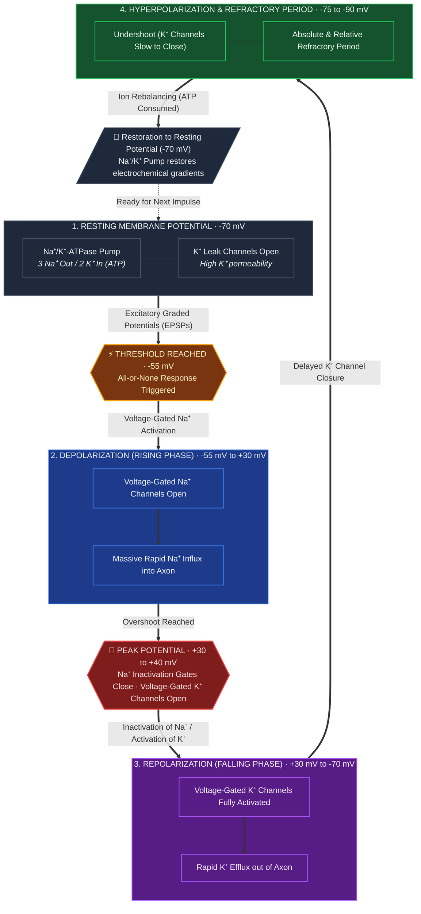

# Content
* Also known as a **nerve impulse** or "**spike**" when in a [[Neuron|neuron]] is a series of quick changes in [[Voltage|voltage]] across a [[Cell membrane|cell membrane]].
* This occurs when the [[Membrane potential|membrane potential]] of a specific [[Cell|cell]] rapidly rises and falls.
## Diagram
