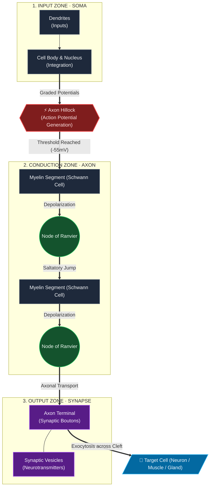

# Content
* A long slender [[Cellular extensions| projection]] of a nerve [[Cell | cell]] or [[Neuron | neuron]] found in most [[Animal| animals]] that typically conducts eletrectrical impulses known as [[Action potentials | action potentials]] away from the [[Soma | nerve cell body]].
* Its function is to transmit information to different neurons, muscles and glands.
## Diagram
