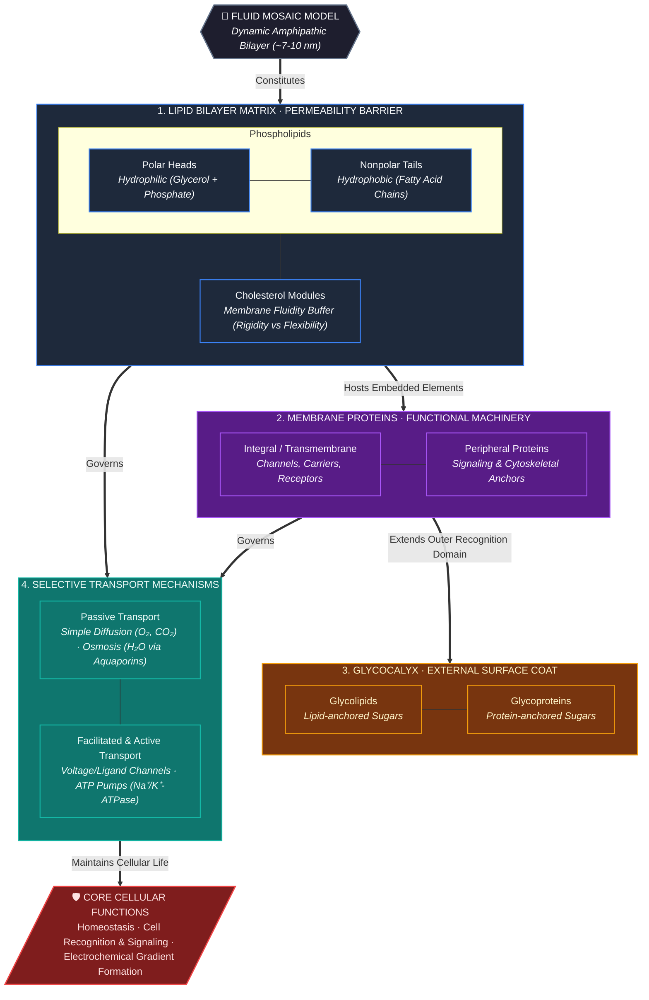

# Content
* Also known as the **plasma membrane** or **cytoplasmic membrane**.
* Is a [[Semipermeable biological membrane|semipermeable biological membrane]] that separates and protects the interior of a [[Cell|cell]] from the outside enviroment.
# Diagram
