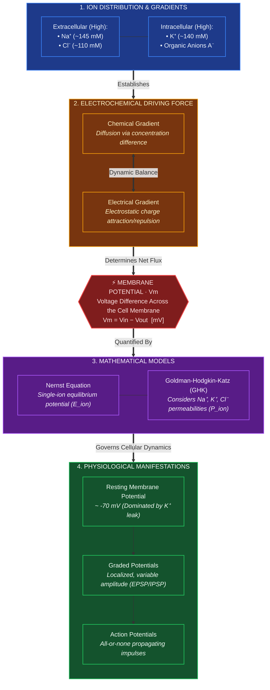

# Content
* Also known as **trans membrane potential** or **membrane voltage**.
* Is the difference in [[Electric potential|electric potential]] between the interior and the exterior of a biological [[Cell|cell]].
# Diagram
