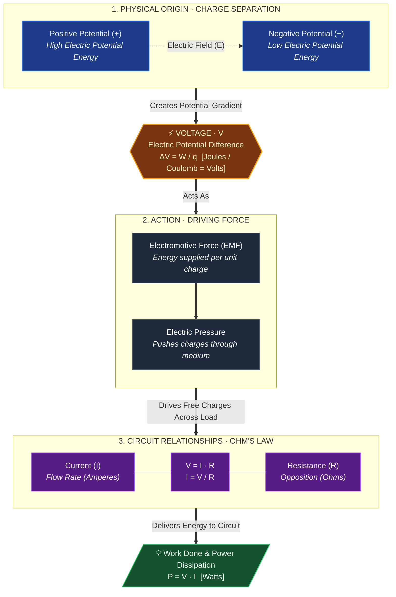

# Content
* Also known as **electrical potential difference**, **electric presure** or **electric tension**, is the difference in [[Electric potential|electric potential]] between two points.
# Diagram
